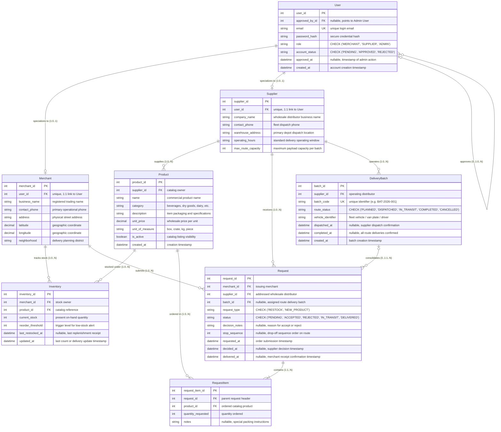

# SupplyLink — Entity-Relationship Specification (3NF Relational Data Model)

This document provides the formal relational data model for the **SupplyLink** Supplier-Merchant Ordering and Delivery Platform, derived directly from the academic Gane & Sarson Data Flow Diagrams (Context Diagram, Level 0 DFD, and Scenario Walkthrough).

---

## 1. Executive Summary & Design Principles

The SupplyLink relational schema is engineered to satisfy strict **Third Normal Form (3NF)** requirements while preserving full semantic fidelity to the system's operational requirements:
- **No Repeating Groups (1NF)**: Multi-item merchant requests are decomposed into header (`Request`) and line item (`RequestItem`) entities.
- **Full Functional Dependency (2NF)**: All non-key attributes are fully functionally dependent on the entire primary key. Composite junction entities isolate attributes specific to their relationship.
- **No Transitive Dependencies (3NF)**: Attributes depend solely on the primary key. External entity profiles (`Merchant`, `Supplier`) are segregated from core identity/authentication (`User`).
- **Zero Derived or Computed Redundancy**: Aggregated statistics for reports (Process 6.0), order sub-totals, and inventory alert states are calculated on-the-fly via queries rather than persisted.
- **Decoupled Route Logistics**: Persistent delivery batches (`DeliveryBatch`) consolidate accepted requests into dynamic geographic delivery routes dispatched ASAP, without speculative driving or calendar constraints.

---

## 2. Mermaid Entity-Relationship Diagram

---

## 3. DFD to ERD Mapping Matrix

The table below traces every data store, external entity, and labeled data flow from the DFD specification directly into the relational schema.

| DFD Element | DFD Description | ERD Entity / Junction | ERD Attributes & Foreign Keys | Mapping Rationale & Normalization Decision |
| :--- | :--- | :--- | :--- | :--- |
| **D1: Users and profiles** | Persistent store for all platform user records, business locations, and delivery constraints | `User` `Merchant` `Supplier` | `User.user_id`, `email`, `password_hash`, `role`, `account_status`, `approved_by_id`, `approved_at` `Merchant.merchant_id`, `user_id`, `address`, `latitude`, `longitude`, `neighborhood` `Supplier.supplier_id`, `user_id`, `warehouse_address`, `operating_hours`, `max_route_capacity` | **Class-Subclass Specialization (3NF)**: Prevents null-laden tables and eliminates redundancy. Common credentials and admin verification reside in `User`; operational geometries (coordinates for route planning) and fleet delivery settings reside in `Merchant` and `Supplier`. |
| **D2: Products** | Persistent product catalog owned and maintained by wholesale suppliers | `Product` | `product_id`, `supplier_id` (FK), `name`, `category`, `description`, `unit_price`, `unit_of_measure`, `is_active` | **Direct Entity Mapping**: Fully owned by Supplier (`1:N`). Serves Process 2.0 (catalog updates) and provides product lookup/validation for Process 4.0 order creation. |
| **D3: Inventory** | Persistent merchant stock levels and reorder thresholds | `Inventory` | `inventory_id`, `merchant_id` (FK), `product_id` (FK), `current_stock`, `reorder_threshold`, `last_restocked_at`, `updated_at` | **M:N Junction Entity (3NF)**: Resolves the many-to-many relationship between `Merchant` and `Product`. Enforces unique composite key `(merchant_id, product_id)`. Directly drives Process 3.0 threshold alerts (`current_stock <= reorder_threshold`) and receives Process 5.0 stock increments. |
| **D4: Requests** | Persistent orders for restock items and new product introductions | `Request` `RequestItem` | `Request.request_id`, `merchant_id` (FK), `supplier_id` (FK), `batch_id` (FK, nullable), `request_type`, `status`, `decision_notes`, `stop_sequence` `RequestItem.request_item_id`, `request_id` (FK), `product_id` (FK), `quantity_requested`, `notes` | **1NF / 3NF Header-Line Decomposition**: Resolves multi-item repeating groups. `Request` captures lifecycle and supplier decision; `RequestItem` captures individual product lines. Links to `DeliveryBatch` via `batch_id` when accepted. |
| **D5: Delivery batches** | Persistent consolidated trips grouping nearby merchant drop-offs into routes | `DeliveryBatch` | `batch_id`, `supplier_id` (FK), `batch_code`, `route_status`, `vehicle_identifier`, `dispatched_at`, `completed_at`, `created_at` | **Direct Entity Mapping**: Grouped dynamically by Process 5.0. Contains 1..N accepted requests. Dispatched ASAP based on supplier vehicle limits and merchant geographic proximity. |
| **e_merchant** (Entity) | Retail merchant (Source & Sink) | `Merchant` + `User` (`role='MERCHANT'`) | Mapped via `User.user_id = Merchant.user_id` | Full identity, GPS coordinates, and neighborhood metadata. |
| **e_supplier** (Entity) | Wholesale distributor (Source & Sink) | `Supplier` + `User` (`role='SUPPLIER'`) | Mapped via `User.user_id = Supplier.user_id` | Owns catalog (`Product`), operates fleet batches (`DeliveryBatch`), reviews `Request`. |
| **e_admin** (Entity) | Platform supervisor (Source & Sink) | `User` (`role='ADMIN'`) | Mapped via `User.approved_by_id -> User.user_id` | Audits onboarding via `User.account_status`; reviews dynamic analytics from Process 6.0. |

### Complete Flow Traceability Table

| DFD Flow ID | Flow Name & Direction | Participating Entities / Attributes | Operational Function in Relational Model |
| :--- | :--- | :--- | :--- |
| `f_m_reg_1` | Merchant registration details | `User`, `Merchant` | Inserts new `User` record (`status='PENDING'`) and associated `Merchant` profile with coordinates. |
| `f_1_stat_m` | Account status (P1 -> Merchant) | `User.account_status` | Returns onboarding status (`PENDING`, `APPROVED`, `REJECTED`) to merchant. |
| `f_s_reg_1` | Supplier registration & settings | `User`, `Supplier` | Inserts new `User` and `Supplier` profile with warehouse address and fleet delivery settings. |
| `f_1_stat_s` | Account status (P1 -> Supplier) | `User.account_status` | Returns onboarding status to supplier. |
| `f_a_app_1` | User approvals (Admin -> P1) | `User.account_status`, `approved_by_id`, `approved_at` | Updates pending record to `APPROVED` or `REJECTED`, recording admin audit trail. |
| `f_1_pend_a` | Pending registrations (P1 -> Admin) | `User` (where `account_status = 'PENDING'`) | Query filter returning unapproved user registrations for administrative review. |
| `f_1_d1` / `f_d1_1` | Profile updates & reads | `User`, `Merchant`, `Supplier` | Read/write access for user authentication, contact information, and operating parameters. |
| `f_s_cat_2` | Product catalog (Supplier -> P2) | `Product` | Supplier creates or edits catalog listings (`name`, `price`, `unit`, `category`). |
| `f_2_d2` / `f_d2_2` | Catalog updates & data | `Product` | Read/write synchronization between Process 2.0 and D2 Products. |
| `f_m_stock_3` | Stock levels (Merchant -> P3) | `Inventory.current_stock`, `updated_at` | Merchant submits physical count updates to Process 3.0. |
| `f_3_alert_m` | Low-stock alerts (P3 -> Merchant) | `Inventory` (`current_stock <= reorder_threshold`) | Dynamic threshold evaluation triggering an automated notification payload. |
| `f_d3_3` / `f_3_d3` | Stock data & updates | `Inventory` | Read threshold limits; write inventory adjustments to D3. |
| `f_m_req_4` | Requests (Merchant -> P4) | `Request`, `RequestItem` | Inserts `Request` (`status='PENDING'`) and line item quantities. |
| `f_s_dec_4` | Request decisions (Supplier -> P4) | `Request.status`, `decision_notes`, `decided_at` | Updates request status to `ACCEPTED` or `REJECTED` with timestamp and reason. |
| `f_d2_det_4` | Product details (D2 -> P4) | `Product` (`unit_price`, `is_active`) | Validates item existence and active status before order logging. |
| `f_4_stat_m` | Request status (P4 -> Merchant) | `Request.status`, `decision_notes` | Delivers real-time decision status back to requesting merchant. |
| `f_4_new_s` | New requests (P4 -> Supplier) | `Request`, `RequestItem`, `Merchant` | Notifies supplier of incoming order lines awaiting acceptance. |
| `f_d4_4` / `f_4_d4` | Request records & updates | `Request`, `RequestItem` | Read/write operations tracking request lifecycle in D4. |
| `f_d4_acc_5` | Accepted requests (D4 -> P5) | `Request` (`status='ACCEPTED'`, `batch_id IS NULL`) | Queries all unbatched accepted orders for route optimization. |
| `f_d1_loc_5` | Locations & settings (D1 -> P5) | `Merchant.latitude`, `longitude`, `Supplier.max_route_capacity` | Pulls geographic coordinates and vehicle rules for cluster batching. |
| `f_5_d5` | Batches (P5 -> D5) | `DeliveryBatch`, `Request.batch_id`, `stop_sequence` | Creates `DeliveryBatch` record and links consolidated requests with route stop order. |
| `f_5_batch_s` | Delivery batches (P5 -> Supplier) | `DeliveryBatch` joined with `Request`, `Merchant` | Transmits manifest with drop-off stops and quantities to supplier fleet. |
| `f_s_disp_5` | Dispatch confirmation (Supplier -> P5) | `DeliveryBatch.route_status`, `dispatched_at`, `Request.status` | Sets batch to `DISPATCHED` / `IN_TRANSIT` and updates all assigned requests. |
| `f_5_stat_m` | Delivery status (P5 -> Merchant) | `Request.status`, `DeliveryBatch.route_status` | Delivers live transit updates to merchants on the active delivery route. |
| `f_m_rec_5` | Receipt confirmation (Merchant -> P5) | `Request.status='DELIVERED'`, `delivered_at` | Merchant confirms goods arrival, updating request lifecycle to terminal state. |
| `f_5_d3` | Stock update (P5 -> D3) | `Inventory.current_stock` | Automated reconciliation incrementing stock count by received `RequestItem.quantity_requested`. |
| `f_d4_rep_6` | Request data (D4 -> P6) | `Request`, `RequestItem` | Aggregation queries computing order volume, fulfillment rates, and turnaround times. |
| `f_d5_rep_6` | Batch data (D5 -> P6) | `DeliveryBatch` | Aggregation queries computing fleet utilization, route lengths, and dispatch efficiency. |
| `f_6_rep_a` | Reports (P6 -> Admin) | Dynamic Query Projections | Formatted analytics presented to Admin (no stored report entity required). |

---

## 4. Comprehensive Data Dictionary

### 4.1. Entity: `User`
Stores authentication credentials, system role, and administrative onboarding approval state.

| Column | Data Type | Constraints | Description |
| :--- | :--- | :--- | :--- |
| `user_id` | `INT` | `PRIMARY KEY`, `AUTO_INCREMENT` | Surrogate primary key uniquely identifying each platform account. |
| `approved_by_id` | `INT` | `FOREIGN KEY` references `User(user_id)`, `NULLABLE` | Admin account that reviewed and approved this registration. |
| `email` | `VARCHAR(255)` | `NOT NULL`, `UNIQUE` | Unique email address utilized for system login and formal notifications. |
| `password_hash` | `VARCHAR(255)` | `NOT NULL` | Cryptographic hash of the account authentication password. |
| `role` | `VARCHAR(20)` | `NOT NULL`, `CHECK (role IN ('MERCHANT', 'SUPPLIER', 'ADMIN'))` | System role governing permission boundary and profile subtype. |
| `account_status` | `VARCHAR(20)` | `NOT NULL`, `DEFAULT 'PENDING'`, `CHECK (account_status IN ('PENDING', 'APPROVED', 'REJECTED'))` | Lifecycle state of user registration under administrative governance. |
| `approved_at` | `DATETIME` | `NULLABLE` | Timestamp when administrative approval or rejection occurred. |
| `created_at` | `DATETIME` | `NOT NULL`, `DEFAULT CURRENT_TIMESTAMP` | System timestamp when registration was submitted. |

### 4.2. Entity: `Merchant`
Subtype profile containing retail business identity, delivery address, and geographic coordinates for route batching.

| Column | Data Type | Constraints | Description |
| :--- | :--- | :--- | :--- |
| `merchant_id` | `INT` | `PRIMARY KEY`, `AUTO_INCREMENT` | Unique identifier for the merchant business. |
| `user_id` | `INT` | `NOT NULL`, `UNIQUE`, `FOREIGN KEY` references `User(user_id)` | Mandatory 1:1 foreign key linking profile to base credentials. |
| `business_name` | `VARCHAR(150)` | `NOT NULL` | Registered commercial trading name of the retail shop or kiosk. |
| `contact_phone` | `VARCHAR(30)` | `NOT NULL` | Direct telephone number of shop owner / receiving clerk. |
| `address` | `VARCHAR(255)` | `NOT NULL` | Physical street address for physical goods delivery. |
| `latitude` | `DECIMAL(10, 7)` | `NOT NULL` | Exact GPS latitude used by Process 5.0 for route proximity clustering. |
| `longitude` | `DECIMAL(10, 7)` | `NOT NULL` | Exact GPS longitude used by Process 5.0 for route proximity clustering. |
| `neighborhood` | `VARCHAR(100)` | `NOT NULL` | Urban district or postal zone used for macro-level delivery grouping. |

### 4.3. Entity: `Supplier`
Subtype profile containing wholesale distributor identity, dispatch depot location, and fleet operating constraints.

| Column | Data Type | Constraints | Description |
| :--- | :--- | :--- | :--- |
| `supplier_id` | `INT` | `PRIMARY KEY`, `AUTO_INCREMENT` | Unique identifier for the wholesale supplier entity. |
| `user_id` | `INT` | `NOT NULL`, `UNIQUE`, `FOREIGN KEY` references `User(user_id)` | Mandatory 1:1 foreign key linking profile to base credentials. |
| `company_name` | `VARCHAR(150)` | `NOT NULL` | Registered corporate name of the wholesale distributor. |
| `contact_phone` | `VARCHAR(30)` | `NOT NULL` | Central dispatch office contact telephone. |
| `warehouse_address` | `VARCHAR(255)` | `NOT NULL` | Depot loading facility where delivery batches originate. |
| `operating_hours` | `VARCHAR(100)` | `NOT NULL` | Operating window during which delivery fleets execute routes. |
| `max_route_capacity`| `INT` | `NOT NULL` | Maximum vehicle package capacity constraint used during route grouping. |

### 4.4. Entity: `Product`
Persistent catalog items maintained by wholesale suppliers in D2 Products.

| Column | Data Type | Constraints | Description |
| :--- | :--- | :--- | :--- |
| `product_id` | `INT` | `PRIMARY KEY`, `AUTO_INCREMENT` | Unique primary key identifying the catalog product. |
| `supplier_id` | `INT` | `NOT NULL`, `FOREIGN KEY` references `Supplier(supplier_id)` | Owning supplier that manufactures or distributes this item. |
| `name` | `VARCHAR(150)` | `NOT NULL` | Official brand and product title. |
| `category` | `VARCHAR(80)` | `NOT NULL` | Product category (e.g. Dry Food, Beverages, Cleaning Supplies). |
| `description` | `TEXT` | `NULLABLE` | Detailed specifications, packaging size, and handling requirements. |
| `unit_price` | `DECIMAL(10, 2)` | `NOT NULL`, `CHECK (unit_price >= 0)` | Wholesale unit price offered by the supplier. |
| `unit_of_measure` | `VARCHAR(30)` | `NOT NULL` | Packaging denomination (e.g. 'Carton', 'Crate 24x', '50kg Bag'). |
| `is_active` | `BOOLEAN` | `NOT NULL`, `DEFAULT TRUE` | Flag indicating whether product is actively available for ordering. |
| `created_at` | `DATETIME` | `NOT NULL`, `DEFAULT CURRENT_TIMESTAMP` | Catalog item creation timestamp. |

### 4.5. Entity: `Inventory`
Merchant stock tracking and low-stock threshold configuration in D3 Inventory.

| Column | Data Type | Constraints | Description |
| :--- | :--- | :--- | :--- |
| `inventory_id` | `INT` | `PRIMARY KEY`, `AUTO_INCREMENT` | Unique surrogate key for the stock record. |
| `merchant_id` | `INT` | `NOT NULL`, `FOREIGN KEY` references `Merchant(merchant_id)` | Merchant owning this on-hand inventory. |
| `product_id` | `INT` | `NOT NULL`, `FOREIGN KEY` references `Product(product_id)` | Product item being tracked. |
| `current_stock` | `INT` | `NOT NULL`, `DEFAULT 0`, `CHECK (current_stock >= 0)` | Present physical count available on merchant shelf. |
| `reorder_threshold` | `INT` | `NOT NULL`, `DEFAULT 10`, `CHECK (reorder_threshold >= 0)` | Threshold below which Process 3.0 fires low-stock alert. |
| `last_restocked_at` | `DATETIME` | `NULLABLE` | Timestamp of most recent goods arrival and inventory increment. |
| `updated_at` | `DATETIME` | `NOT NULL`, `DEFAULT CURRENT_TIMESTAMP ON UPDATE CURRENT_TIMESTAMP` | Last stock adjustment or count reporting timestamp. |
| *Composite UK* | `UNIQUE (merchant_id, product_id)` | Unique constraint preventing duplicate stock rows for the same product. |

### 4.6. Entity: `Request`
Header record for replenishment and new-product orders placed by merchants in D4 Requests.

| Column | Data Type | Constraints | Description |
| :--- | :--- | :--- | :--- |
| `request_id` | `INT` | `PRIMARY KEY`, `AUTO_INCREMENT` | Unique primary key identifying the order request. |
| `merchant_id` | `INT` | `NOT NULL`, `FOREIGN KEY` references `Merchant(merchant_id)` | Retail merchant who created the request. |
| `supplier_id` | `INT` | `NOT NULL`, `FOREIGN KEY` references `Supplier(supplier_id)` | Targeted wholesale supplier requested to fulfill goods. |
| `batch_id` | `INT` | `NULLABLE`, `FOREIGN KEY` references `DeliveryBatch(batch_id)` | Assigned delivery route batch (populated upon Process 5.0 batching). |
| `request_type` | `VARCHAR(20)` | `NOT NULL`, `CHECK (request_type IN ('RESTOCK', 'NEW_PRODUCT'))` | Distinction between routine restock and initial catalog sample. |
| `status` | `VARCHAR(20)` | `NOT NULL`, `DEFAULT 'PENDING'`, `CHECK (status IN ('PENDING', 'ACCEPTED', 'REJECTED', 'IN_TRANSIT', 'DELIVERED'))` | Lifecycle state of request from submission through receipt. |
| `decision_notes` | `TEXT` | `NULLABLE` | Explanation provided by supplier upon acceptance or rejection. |
| `stop_sequence` | `INT` | `NULLABLE`, `CHECK (stop_sequence > 0)` | Drop-off stop number along the assigned delivery batch route. |
| `requested_at` | `DATETIME` | `NOT NULL`, `DEFAULT CURRENT_TIMESTAMP` | Timestamp of merchant submission. |
| `decided_at` | `DATETIME` | `NULLABLE` | Timestamp of supplier accept/reject decision. |
| `delivered_at` | `DATETIME` | `NULLABLE` | Timestamp when merchant confirmed physical delivery receipt. |

### 4.7. Entity: `RequestItem`
Line item junction table decomposing multi-item orders into 3NF.

| Column | Data Type | Constraints | Description |
| :--- | :--- | :--- | :--- |
| `request_item_id` | `INT` | `PRIMARY KEY`, `AUTO_INCREMENT` | Unique primary key identifying the individual line item. |
| `request_id` | `INT` | `NOT NULL`, `FOREIGN KEY` references `Request(request_id)` | Parent order header reference. |
| `product_id` | `INT` | `NOT NULL`, `FOREIGN KEY` references `Product(product_id)` | Catalog item requested. |
| `quantity_requested`| `INT` | `NOT NULL`, `CHECK (quantity_requested > 0)` | Quantity ordered by the merchant. |
| `notes` | `VARCHAR(255)` | `NULLABLE` | Item-specific packing or handling notes. |
| *Composite UK* | `UNIQUE (request_id, product_id)` | Prevents duplicate lines for the identical product in one order. |

### 4.8. Entity: `DeliveryBatch`
Persistent consolidated delivery routes generated by Process 5.0 in D5 Delivery batches.

| Column | Data Type | Constraints | Description |
| :--- | :--- | :--- | :--- |
| `batch_id` | `INT` | `PRIMARY KEY`, `AUTO_INCREMENT` | Unique primary key identifying the route trip. |
| `supplier_id` | `INT` | `NOT NULL`, `FOREIGN KEY` references `Supplier(supplier_id)` | Wholesale supplier operating the delivery vehicle. |
| `batch_code` | `VARCHAR(50)` | `NOT NULL`, `UNIQUE` | Human-readable manifest tracking number (e.g., 'BAT-2026-0412'). |
| `route_status` | `VARCHAR(20)` | `NOT NULL`, `DEFAULT 'PLANNED'`, `CHECK (route_status IN ('PLANNED', 'DISPATCHED', 'IN_TRANSIT', 'COMPLETED', 'CANCELLED'))` | Transit status of the grouped delivery trip. |
| `vehicle_identifier`| `VARCHAR(100)` | `NOT NULL` | Assigned van/truck fleet identifier or driver name. |
| `dispatched_at` | `DATETIME` | `NULLABLE` | Timestamp when supplier confirmed vehicle departure. |
| `completed_at` | `DATETIME` | `NULLABLE` | Timestamp when final merchant drop-off was confirmed. |
| `created_at` | `DATETIME` | `NOT NULL`, `DEFAULT CURRENT_TIMESTAMP` | Timestamp when Process 5.0 assembled the batch. |

---

## 5. Normalization Justification (3NF Compliance)

### 5.1. First Normal Form (1NF)
1. **Atomic Attributes**: All columns store single, atomic values. Multi-valued elements (e.g. list of ordered products in a request) are decomposed into the `RequestItem` relation.
2. **Defined Primary Keys**: Every entity possesses an unambiguous, surrogate integer primary key (`user_id`, `merchant_id`, `supplier_id`, `product_id`, `inventory_id`, `request_id`, `request_item_id`, `batch_id`).
3. **No Repeating Groups**: Neither `Request` nor `DeliveryBatch` store arrays or repeating columns (`item_1`, `item_2`). Line items are represented as individual rows in `RequestItem`.

### 5.2. Second Normal Form (2NF)
1. **1NF Compliance**: All tables satisfy 1NF.
2. **Full Functional Dependency**: In tables with composite business keys (`Inventory` with `merchant_id` + `product_id`, and `RequestItem` with `request_id` + `product_id`), non-key attributes depend on the complete key:
   - In `Inventory`, `current_stock` and `reorder_threshold` depend on both the merchant AND the product (not just product alone).
   - In `RequestItem`, `quantity_requested` depends on both the order AND the specific product line.
   No partial key dependencies exist.

### 5.3. Third Normal Form (3NF)
1. **2NF Compliance**: All tables satisfy 2NF.
2. **No Transitive Dependencies**: Non-key attributes depend only on the candidate key:
   - In `Request`, merchant geographic coordinates (`latitude`, `longitude`) are NOT duplicated. They are retrieved via `Request.merchant_id -> Merchant.merchant_id`.
   - In `Product`, supplier address or contact info is NOT duplicated. It is retrieved via `Product.supplier_id -> Supplier.supplier_id`.
   - In `User`, `Merchant`, and `Supplier`, authentication credentials are not duplicated in subtype records.
3. **Zero Derived Attributes Persisted**:
   - Total order financial amount is NOT stored in `Request`; it is computed as `SUM(RequestItem.quantity_requested * Product.unit_price)`.
   - Low-stock state is NOT stored as a boolean column in `Inventory`; it is dynamically queried as `current_stock <= reorder_threshold`.
   - Administrative report summaries are NOT persisted in a "Reports" table; Process 6.0 computes aggregations directly from `Request`, `RequestItem`, and `DeliveryBatch`.

---

## 6. Key Assumptions and Domain Constraints

1. **Internal Fleet Logistics**: In accordance with the system design specification, drivers and delivery vehicles are internal assets of the `Supplier`. The platform coordinates delivery manifests and route stops at the supplier level; individual driver accounts are outside system boundaries.
2. **Dynamic On-Demand Dispatch**: Delivery batches are assembled dynamically by Process 5.0 when confirmed orders reach efficient geographic proximity or capacity limits (`max_route_capacity`), avoiding artificial calendar delays.
3. **Strict Stock Reconciliation**: Physical receipt confirmation by the merchant (`f_m_rec_5`) triggers an automated transactional increment of `Inventory.current_stock` for each item delivered, ensuring stock synchronization without manual dual-entry.
4. **Administrative Oversight**: Admin users are platform supervisors responsible for verifying business onboarding and reviewing operational throughput reports, but do not participate directly in order creation or routing transactions.
